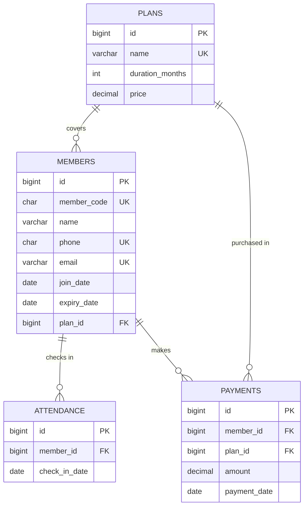

# Database ER diagram

The member code, phone, and email are unique. Attendance has a unique `(member_id, check_in_date)` key so a member cannot be checked in twice on the same day. A member belongs to one plan; a plan may be assigned to many members. Attendance belongs to one member. Each payment belongs to a member and records the plan purchased at that time, so the history remains accurate if the member later changes plans.
